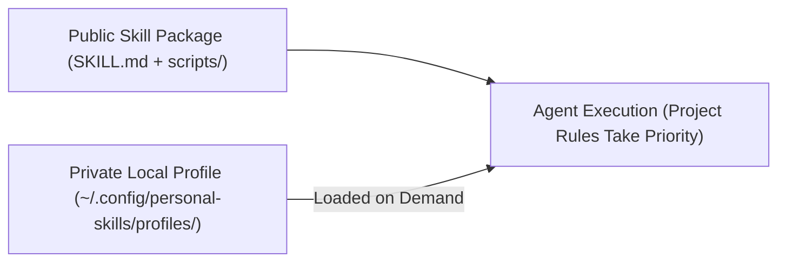

# Personal skills

**English** · [简体中文](README.zh-CN.md)

Personal working methods and reusable workflows for coding agents ([MIT License](LICENSE)).
Defaults reflect explicit preferences—BrowserOS neo for web tasks, compact desktop UIs, explicit human authorization, and readback-verified completion—while user requests and project rules always take priority.



## Skills (24 Packages)

| Skill | Method |
| --- | --- |
| `agent-auth` | Automate SMS/email OTPs, desktop WeChat quick-login, Keychain TOTP, and Chrome-to-iPhone QR logins under 3-tier guardrails |
| `agent-browser` | Choose direct reading or Neo; preserve login and task-tab boundaries |
| `daily-brief-feedback` | Record exact human feedback without inventing preference labels |
| `delivery` | Carry changes through direct delivery or bounded P0/P1 PR review, fast/slow test tiers, and authorized completion |
| `doubao-search` | Query Feishu enterprise knowledge and qualify source verification |
| `english-learning` | Teach related vocabulary and file daily English reviews in Notion |
| `google-flow` | Drive Google Flow and Google Flow Music in BrowserOS neo with login, credit, and download checks |
| `iphone-wireless` | Drive a physical iPhone over Wi-Fi via `iphone-wireless`, local Appium, and `wdio-mcp` |
| `learn` | Propose evidence-backed lessons and separate saving from rule application |
| `linkget` | Download offline article archives (X Articles, WeChat, Toutiao, Zhihu, web), media, and transcripts via the local `linkget` CLI |
| `mac-app-replacement` | Replace apps and verify cleanup of confirmed obsolete copies |
| `neo-xhs-favorites-inventory` | Reconcile favorites coverage, stable identities, and count gaps |
| `notes` | Keep a complete canonical source article and preserve human judgment |
| `notion-trash` | Guard selected trash/restore actions and verify the result |
| `notion-writing` | File readable documents while preserving identity, content, and state |
| `project-audit` | Review a whole project for defects and propose evidence-backed fixes |
| `saved-content-review` | Separate source coverage, verified archival, and authorized cleanup |
| `shop-search` | Search JD and Taobao through explicitly configured routes |
| `social-publish` | Prepare truthful platform-specific launch packages and a pre-publish Notion review gate |
| `tell-dot` | Hand selected material to a verified Finn/Dot recipient and check delivery |
| `ui-preferences` | Apply personal interface preferences with clear scope |
| `voice-memo-notion` | Preserve transcript evidence and verify saved recording notes |
| `walkthrough-video` | Render narrated 1080p walkthrough videos with neural TTS, preview checks, and single-layer subtitles |
| `x-search` | Search public X posts through a configured SocialData account |

## Install & Use

- **Install selectively:** Each folder is a self-contained package (`SKILL.md` + optional scripts/assets). Installing a skill does not install external CLIs, sign into accounts, or enable schedules.
- **Shared delivery defaults:** Install `delivery` and point your harness's global rules to it (`AGENTS.md` / equivalent) rather than duplicating rules.
- **Preserve host manifests:** Keep `SKILL.md` frontmatter (including `disable-model-invocation`) and `agents/openai.yaml` when copying packages.
- **Keep private data out of Git:** Store local destinations, Notion IDs, and adapter config in `~/.config/personal-skills/`. See [docs/SETUP.md](docs/SETUP.md) for per-skill dependencies and `settings.json`.

## Maintenance & Verification

```sh
python3 tools/check_release.py
```

- Authoritative local skills stay symlinked (`~/.cc-switch/skills/<skill>` → this checkout) and sync directly to GitHub after passing release and privacy checks.
- Offline unit tests cover `tests/`, `english-learning/tests/`, `social-publish/tests/`, and `saved-content-review/scripts/` (these do not test live authenticated services).
