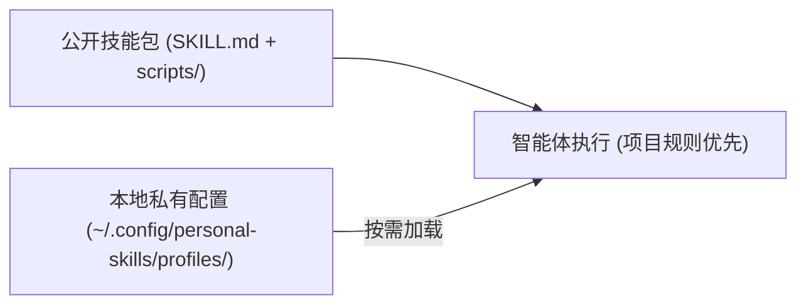

# Personal skills

[English](README.md) · **简体中文**

面向编程智能体的个人工作方法与可复用工作流集合（[MIT 许可证](LICENSE)）。
默认行为体现了明确的个人偏好——网页任务优先使用 BrowserOS neo、紧凑的桌面端 UI、显式人工授权以及回读校验确认完成——同时用户当前请求与项目规则始终具有最高优先级。



## 技能列表（26 个技能包）

| 技能 | 方法 |
| --- | --- |
| `agent-auth` | 在三级安全护栏下自动处理短信/邮件验证码、桌面端微信快捷登录、钥匙串 TOTP 及 Chrome 到 iPhone 的扫码登录 |
| `agent-browser` | 选择直接读取或使用 Neo；保持登录态与任务标签页边界 |
| `council` | 让 Codex、Gemini Neon 与 Command Code（ACP）DeepSeek V4.1 Flash Fast 独立评审，并核实发现的问题 |
| `daily-brief-feedback` | 精确记录人工反馈，不自行编造偏好标签 |
| `delivery` | 通过直接交付或有界 P0/P1 PR 评审、快/慢测试分层以及授权合入完成变更交付 |
| `doubao-search` | 查询飞书企业知识并标注来源核验情况 |
| `english-learning` | 讲解关联词汇并将每日英语复习归档到 Notion |
| `google-flow` | 通过 BrowserOS neo 驱动 Google Flow 与 Google Flow Music，并校验登录、额度、下载及本地深度图预处理结果 |
| `iphone-wireless` | 通过 `iphone-wireless`、本地 Appium 与 `wdio-mcp` 无线控制真机 iPhone |
| `learn` | 提炼有证据支撑的经验教训，并将“保存记录”与“应用为规则”分离 |
| `linkget` | 通过本地 `linkget` CLI 下载离线文章归档（X Articles、微信、头条、知乎及网页）、媒体文件与转录文本 |
| `mac-app-replacement` | 替换应用并核验已确认废弃副本的清理情况 |
| `neo-xhs-favorites-inventory` | 对账小红书收藏夹覆盖率、稳定标识与数量缺口 |
| `notes` | 保留完整的规范源文章与人工判断 |
| `notion-trash` | 保护选定的移入回收站/恢复操作并核验结果 |
| `notion-writing` | 编写结构清晰的文档，同时保留原页面身份、内容与状态 |
| `project-audit` | 对整个项目进行缺陷审计并提出有证据支撑的修复方案 |
| `saved-content-review` | 分离来源覆盖率、已核验归档与授权清理，支持配置收集时间 |
| `shop-search` | 通过明确配置的渠道搜索京东与淘宝商品 |
| `social-publish` | 准备如实的各平台发布物料与发布前 Notion 审核门控 |
| `telegram-digest` | 通过 `tdl` 只读导出 Telegram 群组/频道消息与图片截图，用于提炼带引用的要点摘要 |
| `tell-dot` | 将选定材料交付给经过核验的 Finn/Dot 接收方并检查送达状态 |
| `ui-preferences` | 在明确的作用域内应用个人界面偏好 |
| `voice-memo-notion` | 保留语音转录证据并核验已保存的录音笔记 |
| `walkthrough-video` | 使用神经网络 TTS、预览校验与单层字幕渲染 1080p 旁白演示视频 |
| `x-search` | 通过已配置的 SocialData 账号搜索公开 X 帖子 |

## 安装与使用

- **按需安装：** 每个目录都是一个独立的技能包（`SKILL.md` + 可选的 `scripts/` 或资源）。安装技能不会自动安装外部 CLI、登录账号或启用定时任务。
- **共享交付默认规则：** 安装 `delivery`，并在你使用的编程智能体的全局规则中指向它（`AGENTS.md` 或等效文件），避免重复复制规则。
- **保留宿主清单：** 复制技能包时请保留 `SKILL.md` 的 frontmatter（包括 `disable-model-invocation`）以及 `agents/openai.yaml`。
- **将私有数据留在 Git 之外：** 将本地目标路径、Notion ID 与适配器配置保存在 `~/.config/personal-skills/` 中。各技能依赖与 `settings.json` 详见 [docs/SETUP.md](docs/SETUP.md)。

## 维护与校验

```sh
python3 tools/check_release.py
```

- 本地权威技能保持软链接状态（`~/.cc-switch/skills/<skill>` → 本仓库检出目录），在通过发布与隐私检查后直接同步至 GitHub。
- 离线单元测试覆盖 `tests/`、`english-learning/tests/`、`google-flow/scripts/`、`social-publish/tests/` 与 `saved-content-review/scripts/`（这些测试不覆盖需要实时认证的线上服务）。
